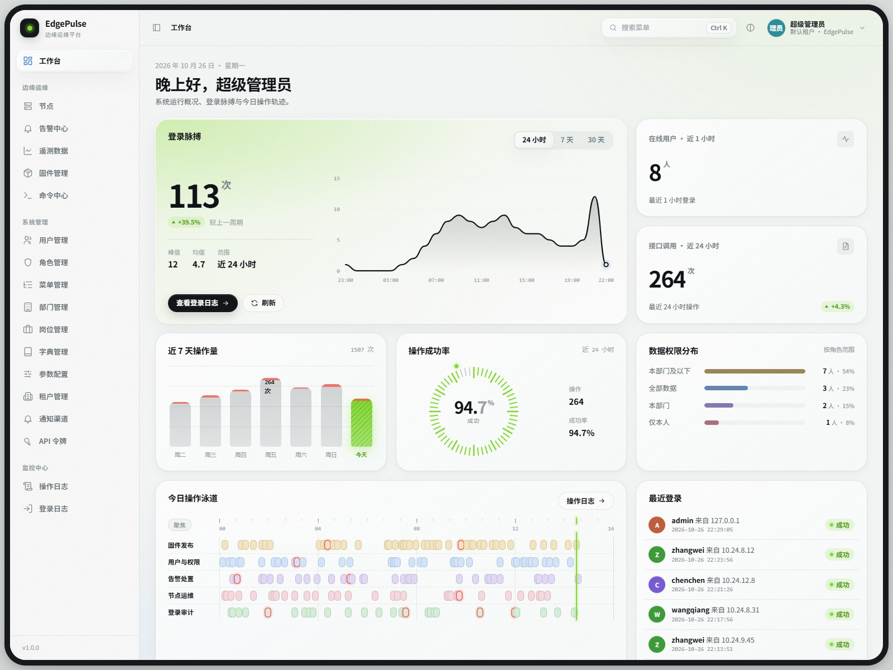
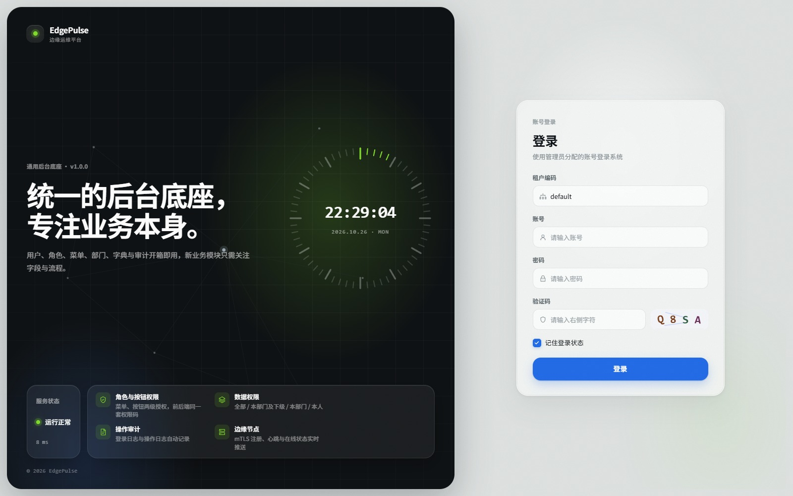
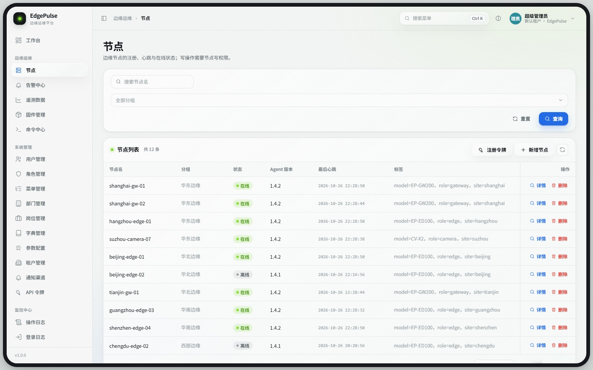
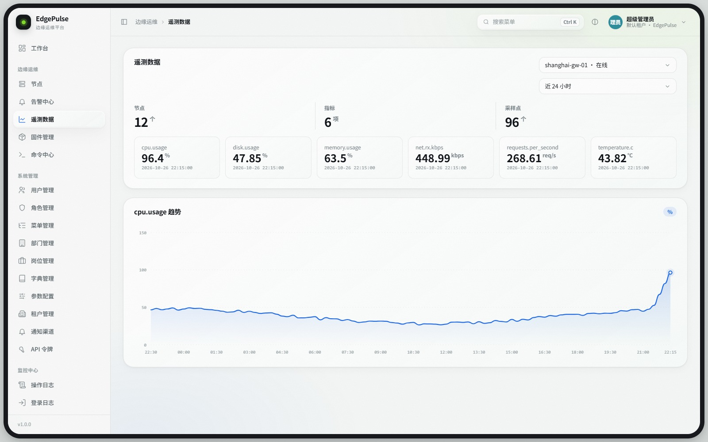
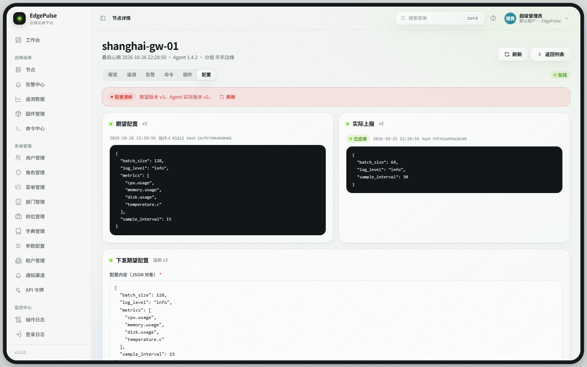
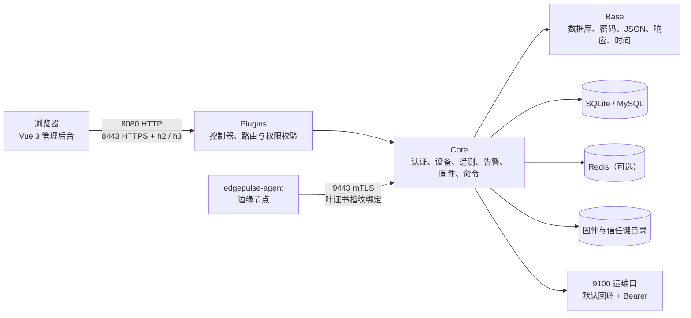
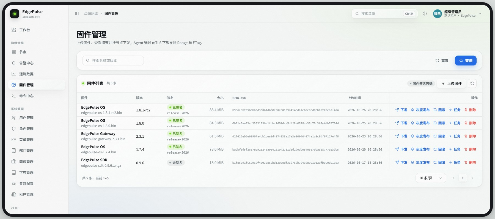
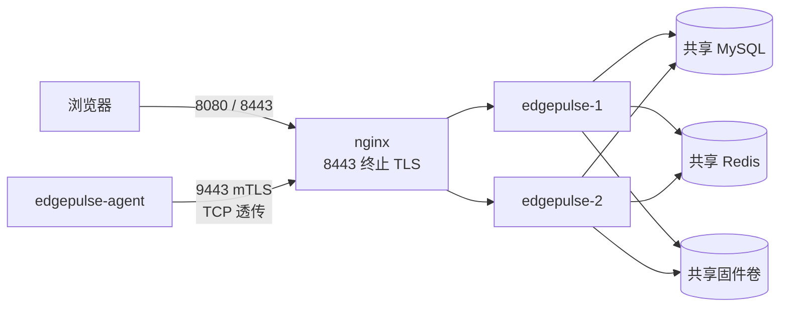

# EdgePulse

<p align="center">
  <b>边缘节点与设备运维平台</b><br>
  C++23 控制面 · Vue 3 管理后台 · mTLS Agent 数据面
</p>

<p align="center">
  <a href="https://github.com/Gyanis9/EdgePulse/actions/workflows/ci.yml"></a>
  <a href="LICENSE"></a>
  
  
  
</p>

<p align="center">
  
</p>

## 目录

- [为什么是 EdgePulse](#为什么是-edgepulse)
- [特性](#特性)
- [界面一览](#界面一览)
- [架构](#架构)
- [快速开始](#快速开始)
- [配置](#配置)
- [运行与端口](#运行与端口)
- [API 与实时通道](#api-与实时通道)
- [固件灰度发布（OTA）](#固件灰度发布ota)
- [安全模型](#安全模型)
- [测试与验收](#测试与验收)
- [部署](#部署)
- [高可用部署](#高可用部署)
- [Agent](#agent)
- [项目结构](#项目结构)
- [Roadmap](#roadmap)
- [贡献](#贡献)
- [许可证](#许可证)

## 为什么是 EdgePulse

边缘节点分散、网络不稳定、证书与固件容易失去追踪。EdgePulse 把这些环节放进同一套控制面：

- 设备身份是一等公民：Agent 走 mTLS，注册与每次数据面上报都绑定叶证书指纹；一次性注册/改绑令牌负责准入，证书到期与吊销可查、可断链。
- 运维动作形成闭环：心跳超时自动离线并生成系统告警，期望配置有版本、漂移检测、修订历史与回滚，固件在 Ed25519 验签通过后才允许下发。
- 部署形态克制：控制面是单个 C++23 可执行体，开发档用 SQLite，生产档用 MySQL，Redis 承担跨实例会话、验证码挑战与限流计数、登录失败计数、租户状态缓存与实时扇出，前端是可由后端直接托管的 Vue 3 静态站点。
- 默认值偏安全：生产样例要求注册令牌、固件签名、强口令与登录锁定；运维口代码默认只监听回环，生产样例与 Compose 为容器抓取显式绑 0.0.0.0；Webhook 出站默认拒绝私网与云元数据地址。

## 特性

| 领域 | 能力 |
|---|---|
| 认证与权限 | 图形验证码、PBKDF2 登录、OIDC 授权码 + PKCE、不透明 Bearer 会话、动态菜单、权限码、数据范围、操作与登录审计、口令策略、账号锁定、全局限流 |
| 企业身份 | API Token（明文只显示一次、只存 SHA-256、scope 与 owner 当前权限取交集、轮换一小时重叠、吊销保留记录）、TOTP 两步验证（加密秘密、一次性恢复码、登录挑战、管理员重置） |
| API 契约与幂等 | OpenAPI 3.1 契约由源码路由生成并在 CI 校验；写请求支持 `Idempotency-Key`，24 小时内重放已完成响应并对内容冲突返回 409 |
| 多租户 | 租户编码登录、平台管理员跨租户、租户级 RBAC/部门/岗位/字典、节点与遥测/告警/固件/命令按租户隔离、停用租户阻断新登录、实时主题按租户分区 |
| 设备生命周期 | Agent mTLS 注册、叶证书指纹绑定、一次性 `enroll`/`rebind` 令牌、内部 CA 按 CSR 自动签发与续期（旧指纹重叠窗口）、证书到期与吊销、心跳超时离线、系统离线告警、节点详情与分组 |
| 遥测与告警 | HTTP 与 UDP 遥测（HMAC-SHA256 防重放）、告警规则与确认/恢复生命周期、Webhook（HMAC 签名）与 SMTP 通知、投递记录与失败原因 |
| 固件与命令 | 流式上传、ETag 与单段 Range 下载、Ed25519 签名与验签门禁、按波次自动推进的灰度与健康门控、自动回滚、命令批量/计划/取消、Agent WebSocket 推送与轮询兜底 |
| 实时 | 浏览器 WebSocket 的节点/告警/命令主题、告警 SSE、Redis 跨实例事件扇出、Agent 命令长连接 |
| 高可用 | 双实例共享 MySQL/Redis/固件卷，nginx 统一 8080/8443/9443；`sys_lease` 租约与 fence 单飞、MySQL 迁移锁、跨实例 Agent 命令路由、`/readyz` 五项依赖、优雅停机与崩溃切换 |
| 可观测 | Prometheus HTTP 与业务指标、`/readyz`、运维总览、OTLP 指标出口、操作/登录统计与热力图 |
| 交付与运维 | 设备影子配置（期望/实际/漂移/修订/回滚）、备份与恢复工具、Docker Compose、systemd、生产静态站点、Windows/Linux/前端/密钥扫描 CI |

## 界面一览

登录、节点、遥测与设备影子都在同一套管理后台里。

<p>
  
  
  
  
</p>

## 架构



依赖方向固定为 `Base ← Core ← Plugins ← App ← Main`：`Base` 不碰业务，`Core` 承载领域服务与 HTTP 交付原语，`Plugins` 只做参数解析、权限校验与响应组装，`App` 负责监听器与工作线程装配，`Main` 只剩进程入口。引擎 `3rd/AsynGyanis` 只读，以 Conan 包消费。

更细的模块、存储表与协议说明见 [docs/架构.md](docs/架构.md)。

## 快速开始

### 前置条件

- Windows + MSVC ≥ 19.40，或 Linux + GCC 14（引擎包用 GCC 13 预构建）/ Clang ≥ 17
- CMake ≥ 3.25、Ninja、Conan 2、Python 3、Node.js ≥ 20
- Git（含 submodule）、OpenSSL（开发证书与固件签名）

### 构建后端

```bash
git submodule update --init --recursive

conan create 3rd/AsynGyanis/packaging/conan --build=missing \
  -s compiler.cppstd=23 -s build_type=Release -o "&:with_mysql=True"

conan install . --build=missing -s compiler.cppstd=23 -s build_type=Release
cmake --preset debug
cmake --build --preset debug
ctest --preset debug --output-on-failure
```

`debug` 预设使用 RelWithDebInfo；Windows/MSVC 下强制 `/MD` 运行期库，与 Release 引擎包保持同一 CRT，混用 `/MDd` 会在链接期报 LNK2038。

Linux 上引擎包固定用系统 GCC 13 构建，EdgePulse 本体用 GCC 14：引擎以 `-Werror` 编译，GCC 14 会在其协程析构上报 `maybe-uninitialized` 误报。Ubuntu 24.04 示例：

```bash
CC=gcc CXX=g++ conan create 3rd/AsynGyanis/packaging/conan --build=missing \
  -s compiler.cppstd=23 -s build_type=Release -o "&:with_mysql=True"
CC=gcc-14 CXX=g++-14 conan install . --build=missing -s compiler.cppstd=23 -s build_type=Release
CC=gcc-14 CXX=g++-14 cmake --preset debug
```

### 启动开发实例

```bash
bash scripts/dev-certs.sh     # CA、服务器、Agent 与对照证书，写入未跟踪的 var/certs
bash scripts/run-dev.sh       # 生成/读取运维令牌并前台启动 edgepulse-server
```

打开 `http://127.0.0.1:8080`。迁移 `V2__seed.sql` 仍会插入种子账号 `admin` / `admin123`。生产档启动时若该账号仍验证通过种子口令且未设置 `EDGEPULSE_ADMIN_PASSWORD`，应用会拒绝启动；设置后由启动期替换哈希并清零失败计数。开发档（`captcha.expose_code=true`）或显式设置 `EDGEPULSE_ALLOW_DEFAULT_ADMIN=true` 才保留种子口令；`EDGEPULSE_INITIAL_PASSWORD` 不会改它。

### 前端开发

```bash
cd frontend
npm ci
npm run dev      # http://127.0.0.1:5173，/api 与 /api/ws 代理到 8080
```

生产静态站点：

```bash
bash scripts/build-web.sh
```

脚本把 `frontend/dist` 刷新到未跟踪的 `web/`。后端发现 `web/index.html` 后会自动托管静态文件，并为非 API 深链回退到 SPA 入口。

### 备份与恢复

SQLite 档可在服务运行中取一致快照；恢复前必须停止服务：

```bash
python scripts/backup.py --driver sqlite --db-path var/edgepulse.db \
  --firmware-dir var/firmware --config-dir config \
  --output backups/edgepulse.tar.gz

python scripts/restore.py --archive backups/edgepulse.tar.gz --driver sqlite \
  --db-path var/edgepulse.db --firmware-dir var/firmware --config-dir config \
  --force --dry-run
```

去掉 `--dry-run` 才会真正写入。归档内的 `manifest.json` 会逐文件核对 SHA-256；MySQL 档与更多参数见 [docs/部署.md](docs/部署.md#11-备份与恢复)。

## 配置

`config/dev.yaml` 只放非敏感项；生产从 `config/prod.yaml.example` 复制一份未跟踪的 `config/prod.yaml`。口令与密钥只从环境变量读取：

| 变量 | 用途 |
|---|---|
| `EDGEPULSE_DB_PASSWORD` | MySQL 口令 |
| `EDGEPULSE_REDIS_PASSWORD` | Redis 口令 |
| `EDGEPULSE_OPS_BEARER_TOKEN` | 运维口 Bearer |
| `EDGEPULSE_AGENT_FINGERPRINT` | 可选的单个 Agent 证书固定指纹；为空时只校验证书链 |
| `EDGEPULSE_INITIAL_PASSWORD` | 新建用户与重置密码表单的默认初始口令（预填、可改；不落库、不写日志） |
| `EDGEPULSE_UDP_TELEMETRY_SECRET` | UDP 遥测 HMAC 密钥；启用时至少 16 字节 |
| `EDGEPULSE_OIDC_CLIENT_SECRET` | OIDC 客户端密钥；公共客户端可留空 |
| `EDGEPULSE_MFA_KEY` | 两步验证主密钥，base64 编码的 32 字节；未配置时设置、启用、关闭与换发恢复码返回 503，已启用账号的登录校验也会失败，只能先恢复同一密钥或由管理员重置 |

关键配置项（默认值按开发档 / 生产样例列出）：

| 配置键 | 开发档 | 生产样例 | 说明 |
|---|---|---|---|
| `edgepulse.instance_id` | 空（按 `hostname-pid-random` 生成） | 空；HA 必须显式唯一 | 实例标识，1–128 字符且不含空白；进入日志、租约 holder 与跨实例信封，同时存活的实例必须唯一。Compose 入口脚本还要求只含 `[A-Za-z0-9._-]` |
| `edgepulse.ha.enabled` | `false` | `false`（多实例可改 `true`） | 只影响启动日志的 HA 标记；租约与单飞不依赖它 |
| `edgepulse.agent.enrollment_mode` | `off` | `required` | `required` 时新节点必须持 `enroll` 令牌，换证书必须持 `rebind` 令牌 |
| `edgepulse.agent.heartbeat_interval_seconds` | `10` | `30` | Agent 心跳周期 |
| `edgepulse.agent.heartbeat_timeout_seconds` | `30` | `90` | 超过该时长未心跳即转离线 |
| `edgepulse.agent.offline_sweep_seconds` | `5` | `30` | 离线扫描周期，必须小于心跳超时 |
| `edgepulse.agent_ca.enabled` | `true` | `false` | 启用控制面内部 CA，Agent 可用 `POST /api/agent/certificate/renew` 提交 CSR 换证 |
| `edgepulse.agent_ca.certificate_file` | `var/certs/ca.pem` | `/etc/edgepulse/tls/ca.pem` | 签发 CA；9443 监听开启时必须就是它的信任锚（或包含在拼接信任包里），启动按 SHA-256 指纹核对；监听关闭时不做这项比对 |
| `edgepulse.agent_ca.key_file` | `var/certs/ca-key.pem` | `/etc/edgepulse/agent-ca-key.pem` | CA 私钥独立路径，POSIX 上要求 0600，不要放进公开证书卷、镜像或版本库 |
| `edgepulse.agent_ca.validity_days` / `overlap_hours` | `30` / `24` | `30` / `24` | 新证书有效期（1–3650 天）与旧指纹重叠窗口（1–168 小时）；Agent 配置固定 `renew_before_days` 时必须小于有效期 |
| `edgepulse.firmware.require_signature` | `false` | `true` | 开启后未签名固件不能上传、部署或回滚 |
| `edgepulse.firmware.trusted_keys_dir` | `config/firmware-keys` | `/etc/edgepulse/firmware-keys` | 只放公钥；启用签名时不能为空，生产样例使用绝对路径 |
| `edgepulse.security.password_min_length` | `8` | `10` | 建号、重置与改密共用 |
| `edgepulse.security.password_require_complexity` | `false` | `true` | 要求同时包含大写、小写、数字与符号 |
| `edgepulse.security.login_failure_window_seconds` | `900` | `900` | 账号失败计数窗口 |
| `edgepulse.security.login_max_failures` | `5` | `5` | 窗口内达到该次数后锁定 |
| `edgepulse.security.login_lock_seconds` | `900` | `900` | 锁定时长 |
| `edgepulse.security.allow_private_webhooks` | `true` | `false` | 打开后跳过整个私网/保留段分类，仅云元数据主机名/地址与链路本地元数据段（169.254/16、fe80::/10）仍拒绝；CGNAT、文档/基准测试段、组播、240/4、IPv6 ULA 等也会放行，只用于受信的自托管网关 |
| `server.rate_limit.requests_per_second` | `0.0` | `0.0`（建议按容量设置） | 全局限流，整数或小数均可，`0` 关闭 |
| `server.rate_limit.burst_capacity` | `1.0` | `1.0`（建议覆盖并发突发） | 令牌桶容量，必须不小于 `1` |
| `server.quic.idle_timeout_seconds` | `30` | `30` | h3 传输层空闲超时（秒），1–3600；`server.limits.idle_timeout_ms` 不控制 h3 连接空闲 |

固件签名密钥只把公钥放进信任键目录，私钥留在签名工作站：

```bash
bash scripts/firmware-signing-keygen.sh prod-2026
bash scripts/sign-firmware.sh var/firmware-signing-key.pem <固件> prod-2026
```

上传时带 `X-Firmware-Signature` 与 `X-Firmware-Key-Id`。启用门禁前，先重新上传历史未签名固件的签名版本。热重载只覆盖会话与验证码相关项；监听地址、端口与整个 `server` 段（含 `server.quic` 空闲超时）需要重启生效。

## 运行与端口

| 端口 | 协议 | 用途 |
|---|---|---|
| 8080/TCP | HTTP/1.1 | 开发档控制台、API、WebSocket、SSE；生产档可托管 SPA |
| 8443/TCP | HTTPS + h2 | 控制台与 API；`Alt-Svc` 通告 h3 |
| 8443/UDP | HTTP/3 | 与公开 API 相同的路由 |
| 9443/TCP | HTTPS + mTLS | Agent 注册、心跳、遥测、命令、固件下载与 Agent WebSocket |
| 9100/TCP | HTTP/1.1 | 运维口；代码默认 `127.0.0.1`，生产样例与 Compose 绑 `0.0.0.0`；`/metrics` 与调试端点需 Bearer |
| 9555/UDP | UDP | HMAC 签名的遥测数据报，默认关闭 |

`/healthz` 与 `/readyz` 匿名可读；`/metrics`、`/debug/*` 必须带 `EDGEPULSE_OPS_BEARER_TOKEN`。`ops_address` 的代码默认是 `127.0.0.1`；`config/prod.yaml.example` 与 Compose 为容器抓取显式设为 `0.0.0.0`，此时必须用主机防火墙或容器网络策略限制来源，只在本机抓取时改回回环并核对监听地址。

`/api/health` 与 `/healthz` 只表示进程存活；`/readyz` 依次检查数据库、启停状态、缓存、实时总线与固件目录，任一不就绪返回 503 和第一条原因。HA 部署把 8080/8443/9443 交给 nginx：8080 与 8443 转发到实例的 8080（8443 在 nginx 终止 TLS），9443 只做 TCP 透传；应用容器不发布这些端口。

## API 与实时通道

- 基础路径 `/api`；除匿名端点外使用 `Authorization: Bearer <token>`。
- 响应包络 `{ code, message, data, traceId }`；分页 `{ pageNum, pageSize, total, rows }`，`pageSize` 上限 100。
- 写接口先过 `requireSession(..., 权限码)`，数据查询带租户边界与数据范围。
- 自动化客户端可带 `Idempotency-Key`（8–128 字符）安全重试写请求；24 小时内同键同内容重放首次响应，内容或权限变化返回 409。认证、Agent、令牌、用户/租户写入与流式固件上传等路径不参与缓存。
- `GET /api/openapi.json` 返回 OpenAPI 3.1 契约，包含 `/api/health`；`frontend/public/openapi.json` 由 `python scripts/generate-openapi.py` 生成，CI 用 `--check` 阻止漂移。契约在服务启动时读入内存，重建 `web/` 后需要重启服务。当前仍是 `/api`，没有 `/api/v1` 前缀。

| 分组 | 代表端点 | 说明 |
|---|---|---|
| 认证 | `/api/auth/login`、`/api/auth/me`、`/api/auth/oidc/*` | 验证码、会话、OIDC 一次性 code 换会话 |
| 两步验证 | `/api/auth/mfa`、`/api/auth/mfa/setup`、`/enable`、`/disable`、`/verify`、`/recovery-codes` | TOTP 设置、登录挑战、恢复码与关闭；管理端重置在 `/api/system/users/:id/mfa/reset` |
| API 令牌 | `/api/system/api-tokens`、`/api/system/api-tokens/:id/rotate` | 一次性明文、scope、轮换与吊销；权限码 `system:token:*` |
| 设备 | `/api/nodes`、`/api/nodes/:id`、`/api/node-groups` | 节点 CRUD 与分组；更新带 `version` 乐观锁 |
| 注册令牌 | `/api/enrollment-tokens` | 列表不回显明文；签发响应只出现一次 `token` |
| 证书 | `/api/nodes/:id/certificate/revoke` | 吊销后清空指纹、置离线并关闭该节点 Agent WebSocket |
| 设备影子 | `/api/nodes/:id/config`、`/revisions`、`/rollback` | 期望配置、漂移、不可变修订与回滚 |
| 遥测告警 | `/api/telemetry/*`、`/api/alarms`、`/api/alarm-rules` | 最新值、序列、告警确认与恢复 |
| 固件命令 | `/api/firmware/*`、`/api/commands/*` | 上传、验签策略、灰度、回滚、批量与计划命令 |
| Agent | `/api/agent/*` | 只挂 9443 mTLS；WebSocket 首条 `hello` 复核叶证书 |
| 实时 | `/api/ws`、`/api/events/alarms` | 浏览器 WebSocket 与告警 SSE |
| 运维 | `:9100/metrics`、`/readyz`、`/debug/*` | Prometheus、就绪与诊断 |

完整字段与状态码见 [docs/API.md](docs/API.md)。

浏览器 WebSocket 升级后 5 秒内发送 `{"type":"auth","token":"..."}`，成功后订阅 `nodes`、`alarms`、`commands` 主题。告警 SSE 用 `event: alarm` 推送，每 15 秒注释保活。

## 固件灰度发布（OTA）

灰度发布把一次固件下发拆成有序波次，由 leader 每 5 秒推进一拍；只有上一波健康门控通过才派发下一波，失败可以暂停或自动回滚。创建、查看与人工动作沿用 `device:firmware:upload` / `device:firmware:list`，目标节点必须与固件同租户；强制签名时目标固件与回滚目标都必须已签名。

| 方法 | 路径 | 说明 |
|---|---|---|
| POST | `/api/firmware/{id}/rollouts` | 创建；`{name,nodeIds,policy}`，也可用 `policyJson` 字符串 |
| GET | `/api/firmware/{id}/rollouts` | 按固件分页列出发布头 |
| GET | `/api/firmware/rollouts/{id}` | 发布聚合：发布、波次、目标与门控快照 |
| POST | `/api/firmware/rollouts/{id}/pause` | 暂停；可带 `reason` |
| POST | `/api/firmware/rollouts/{id}/resume` | 恢复；重新开启当前波次观察窗口，不重发已绑定命令 |
| POST | `/api/firmware/rollouts/{id}/promote` | 人工提升；跳过当前波次，最后一波则完成 |
| POST | `/api/firmware/rollouts/{id}/force-promote` | 强制提升；必须带非空 `reason` 并写入波次门控 |
| POST | `/api/firmware/rollouts/{id}/abort` | 中止任意非终止发布，取消在途命令与任务 |
| POST | `/api/firmware/rollouts/{id}/rollback` | 人工回滚；重新下发每个目标的历史已安装版本 |

策略字段（未给出的字段取默认值；未知字段直接拒绝）：

| 字段 | 默认 | 范围与语义 |
|---|---|---|
| `waves` | 必填 | 1–50 波；每波 `percent` 1–100（按累计覆盖比例解释）或 `size` 固定数量且不小于 1；最后一波必须覆盖全部目标 |
| `maxConcurrentPerWave` | `0` | 0–1000，0 表示不限；只约束仍在执行的命令 |
| `settleSeconds` | `60` | 1–604800，且不小于两个 Agent 心跳周期 |
| `observeSeconds` | `120` | 0–604800，沉降结束后继续观察心跳、遥测与告警的时间 |
| `maxWaveSeconds` | `1800` | 1–604800，且不小于 `settleSeconds` 与 `observeSeconds` 的较大值 |
| `minWaveSuccessRatio` | `1.0` | 0–1，本波健康目标占本波目标的最低比例 |
| `minCumulativeSuccessRatio` | `1.0` | 0–1，全部已派发目标的最低健康比例 |
| `maxFailures` | `0` | 0–1000000，0 表示不设上限；按单波失败目标数计 |
| `autoRollback` | `false` | 门控失败或超时后自动回滚 |
| `onTimeout` | `pause` | `pause` 或 `fail`；只在未开启自动回滚时决定超时去向 |
| `requiredFreshTelemetrySeconds` | `300` | 1–604800，门控可接受的最新遥测年龄 |
| `exemptAlarmMetrics` | `[]` | 最多 100 项，每项不超过 64 字节且不能重复 |
| `maintenanceWindow` | 无 | `{start,end,days?}`，HH:MM 按 UTC 当日分钟、可跨午夜；`days` 为 ISO 星期 1–7 |
| `requireInstalledVersion` | `true` | 要求节点上报 `installedFirmwareVersion` 且与目标版本一致 |

发布状态机：

```text
scheduled/preparing -> running -> completed
scheduled/preparing/running -> paused -> running
running/paused/failed -> rolling_back -> rolled_back | rollback_unavailable | failed
任意非终止状态 -> aborted
```

波次状态为 `pending -> dispatching -> observing -> passed | failed`，中止时进入 `skipped`，回滚时为 `rolling_back -> rolled_back | failed`。目标状态为 `pending -> installing -> healthy | failed`，回滚时为 `rolling_back -> rolled_back | failed`；回滚失败的目标在 `health.gate` 里区分 `rollback_failed` 与 `rollback_unavailable`。

健康门控逐个目标检查：

- 命令必须 `succeeded`；任务必须绑定同一 `commandId` 并进入 `installed`，任务自身的 `failed` 或命令 `failed/timeout/canceled` 直接判失败。
- 节点在线，且 `lastSeen` 不早于沉降窗口结束；观察窗口结束时仍未覆盖则判失败。
- `requireInstalledVersion=true` 时 `installedFirmwareVersion` 必须非空且等于目标版本；不一致保持等待，直到观察结束或超时。
- 最新遥测的接收时间不早于沉降窗口结束，年龄不超过 `requiredFreshTelemetrySeconds`；接收与采集时间取同一条样本，采集时间不能早于派发前 300 秒。
- 本波派发后新增的告警判失败，`exemptAlarmMetrics` 中的指标除外。
- 单波/累计成功率与 `maxFailures` 同时满足才通过；乐观估计已无法达标时提前失败，观察结束仍有未定目标时失败，到达 `maxWaveSeconds` 按超时处理。

人工动作：`pause` 接受 `scheduled/preparing/running`（已暂停重复暂停视为成功），`resume` 接受 `paused`（已运行重复恢复视为成功）并把当前波次的观察窗口从恢复时刻重开；`promote` 与 `force-promote` 只接受 `running/paused`，会把当前波次未完成目标按失败收尾；`abort` 接受全部非终止状态（含 `rolling_back`）；`rollback` 接受 `running/paused/failed/rolling_back`，下一次 tick 才真正派发。

自动回滚只重新下发历史版本，不依赖 Agent 本地槽位：

- 回滚命令是新的 `firmware.update`，目标为每个目标记录的 `previousFirmwareId`，必须重新下载、验签、安装并上报版本；没有 A/B 分区、差分下载或本地快照。
- 未下发过安装命令的目标没有可回滚现场，目标记为 `skipped`；没有历史版本、历史固件不存在或强制签名下历史固件未签名时，目标记为 `failed` 且 `gate=rollback_unavailable`。
- 命令失败、任务失败或超时记为 `gate=rollback_failed`；全部目标确认安装历史版本后发布进入 `rolled_back`，部分无法回滚进入 `failed`，全部无法回滚进入 `rollback_unavailable`。
- 回滚确认要求命令成功、任务 `installed` 且节点 `installedFirmwareVersion` 等于历史版本；回滚期限从进入 `rolling_back` 起算，最长 `maxWaveSeconds`。
- 回滚覆盖整笔发布：已通过的波次一并进入 `rolling_back`，后续未派发的波次落 `skipped`；期限到达仍未确认的目标落 `failed` 且 `gate=rollback_failed`，不会悬在 `rolling_back`。
- 进程在回滚中途重启会沿用已绑定的回滚任务与命令，不重复建单；仍在执行的安装命令与在途任务在回滚派发前会被取消，已完成的目标直接进入回滚。

命令取消只做服务端记账：已经取走的命令不会被 Agent 中断，Agent 迟到的 `installed` 回报不能把 `canceled`/`failed` 任务改回已安装，服务端按终局拒绝该回报。

协调与限制：

- 只有 leader 的 `LeaderTick` 每 5 秒调用一次推进，服务自身不判断领导权；每个发布以头部 `version` 做比较交换，follower 不推进。leader 切换可能让某一拍或一次租约过期的推进延后。
- V22 新增 `biz_firmware_rollout`、`biz_firmware_rollout_wave`、`biz_firmware_rollout_target`，并给任务加 `rollout_id/wave_id/command_id`、给节点加 `installed_firmware_version`；V23 增加 `(rollout_id,wave_index)` 唯一索引，V24 把未绑定命令的任务改成唯一负值占位并增加 `(firmware_id,node_id,command_id)` 唯一索引。迁移只追加，升级前照常备份。
- 已知限制：目标只接受节点标识，界面没有分组选择；波次与目标的多次写入和发布头 CAS 不在同一事务，崩溃后由下一拍按目标状态继续；`listDueRollouts` 已改为主键游标分页、每拍窗口 100，活动发布不会因固定窗口被长期饿死，但分组目标与单目标派发成本仍未展开。

节点通过心跳上报 `installedFirmwareVersion`，空值不会清空已有版本；Agent 的固件状态上报可带 `commandId`，只推进该命令绑定的任务，避免不同波次或手工下发的任务互相覆盖。

管理端操作：固件页的“灰度发布”打开向导，按加载到的节点勾选目标（勾选顺序决定波次归属），填写累计波次百分比（默认 5/25/100，最后一波必须 100%），按需调整并发、沉降、观察、单波上限、成功率、失败数、遥测新鲜度、超时动作与自动回滚，提交后直接打开详情。详情每 5 秒轮询，展示发布/波次/目标状态、门控原因与已安装版本，并按状态提供暂停、恢复、提升、强制提升、中止与回滚；发布历史列表接口已提供，但页面尚无独立历史入口。

<p align="center">
  
</p>

## 安全模型

- 浏览器会话：32 字节不透明 Bearer token，存在 Redis 或进程内存储，TTL 默认 7200 秒并滑动续期；不使用 Cookie 承载会话。
- API Token：明文形如 `ep_api_` 加 64 位十六进制，只在创建或轮换响应出现一次；数据库只存 SHA-256 与前缀。令牌继承 owner 的身份但 `platformAdmin` 恒为 false，每次请求按 owner 当前权限与令牌 scope 的交集授权；令牌吊销/过期、owner 或租户停用都会立即失效。`/api/auth/me` 保留给令牌自省；`/api/auth/routes`、`/api/auth/logout` 等浏览器会话端点、浏览器 WebSocket 与改密入口会拒绝令牌。
- TOTP 两步验证：秘密用 `EDGEPULSE_MFA_KEY` 做 AES-256-GCM 加密后落库（可解密用于校验），恢复码用同一主密钥做 HMAC-SHA256 后存储（不可逆）；两者都不以明文落库。登录挑战放在缓存中、300 秒过期、最多 5 次失败并绑定来源 IP；启用、关闭与换发恢复码对错误动态码另有每用户 5 次/300 秒的失败上限，设置入口不计数。MFA 是用户自助启用，没有租户级强制策略。
- 幂等键：只在带 Bearer 的写请求上生效，按令牌与幂等键的 SHA-256 分区；请求指纹覆盖方法、完整 URI、表示头、权限摘要与正文，权限降级后同键重试返回 409 而不是旧的已授权响应。401、403、5xx 与超过 256 KiB 的响应不缓存，认证、Agent、令牌、用户/租户写入与流式上传路径整段排除，避免一次性明文或口令进入幂等表。
- Agent 身份：9443 在 TLS 层校验客户端证书；注册自报的 SHA-256 指纹必须等于本条连接出示的叶证书；心跳、遥测、命令与固件状态都按叶证书绑定节点。开启 `edgepulse.agent_ca` 后，Agent 可在到期前用 CSR 通过 `POST /api/agent/certificate/renew` 换取新证书，服务端在 `overlap_hours` 内同时接受旧指纹；吊销会清空当前与上一枚指纹、置离线并以 1008 关闭已建立的 Agent WebSocket。
- 注册令牌：`enroll` 与 `rebind` 一次性使用，数据库只存 SHA-256，明文只在签发响应出现一次；有效期限制在 300 到 2592000 秒。
- 固件真实性：Ed25519 对文件 SHA-256 的 32 字节摘要签名，算法标识 `ed25519-sha256`；`require_signature=true` 时未签名固件不能上传、部署或回滚。
- 运维口：代码默认只监听回环；生产样例与 Compose 绑 `0.0.0.0`，须由防火墙或网络策略限制来源。`/metrics` 与 `/debug/*` 需要 Bearer，`/healthz` 与 `/readyz` 匿名。
- 出站 SSRF：Webhook 默认拒绝回环、私网、链路本地与云元数据地址，每次投递前复检；开启 `allow_private_webhooks` 会跳过整个私网/保留段分类，只保留云元数据主机名/地址与链路本地元数据段的拒绝，CGNAT、文档/基准测试段、组播、`240/4`、IPv6 ULA 等也会放行，只应在受信的自托管网关开启。
- 登录加固：口令策略、按账号失败锁定、按 IP 登录限频与全局令牌桶限流；审计日志对 `password`、`token`、`captcha` 等字段脱敏。

完整报告渠道、轮换步骤与已知边界见 [SECURITY.md](SECURITY.md)。

## 测试与验收

```bash
# 后端：单元、集成与协议用例
ctest --preset debug --output-on-failure

# 按名称过滤
ctest --preset debug -R "Enrollment|NodeConfig|NodeLifecycle" --output-on-failure

# 前端：API/工具单测 + 类型检查与构建
cd frontend
npm run test:unit
npm run build

# E2E：使用本机已安装的 Edge，不下载浏览器；先准备开发证书，Playwright 会启动后端与 Vite
npm run test:e2e
cd ..

# 全量协议与安全验收
python scripts/generate-openapi.py --check
python scripts/check-acceptance.py

# Agent 端到端：真实 server/agent 二进制，临时 SQLite 库；含双节点灰度与自动回滚
python scripts/check-agent-e2e.py

# SQLite 备份与恢复：往返、边车清理、路径与私钥过滤
python scripts/backup_restore_test.py

# 真机外部依赖：一次性 MySQL 8.4 与 Redis 7 容器，断言 7 项环境门控用例全部执行
python scripts/run-external-tests.py

# MySQL 备份与恢复往返：同样自带一次性容器
python scripts/backup_restore_mysql_test.py

# Docker 全栈：镜像、MySQL/Redis、Prometheus、OTel collector 与优雅停机
python scripts/check-docker-stack.py --build

# HA 双实例：Compose 起 MySQL/Redis/两实例/nginx，断言跨实例会话、命令路由、优雅停机与崩溃切换
python scripts/check-ha-stack.py --require-docker
```

- 2026-10-24 全量回归（`feat/p6-production-agent` @ `bca5b24`）：`ctest --preset debug` 注册 306 项，通过 302，跳过 4，失败 0，耗时 102.95 秒；`npm run test:unit` 30 项、`npm run test:e2e` 9 项全部通过，`npm run build` 类型检查与构建通过；`python scripts/check-acceptance.py` 通过 86 项、失败 0、跳过 0；`python scripts/check-agent-e2e.py` 通过 50 项、失败 0、跳过 0；`python scripts/backup_restore_test.py` 6 项中 5 项通过，1 项 Windows 文件权限位用例按平台跳过；`python scripts/run-external-tests.py` 三项门控用例全部通过、无跳过；`python scripts/backup_restore_mysql_test.py` 完成 MySQL 备份与恢复往返。
- 2026-10-25 P7 门禁（代码基线 `8e3885c`，只含文档改动）：`cmake --build --preset debug` 无待编译目标；`ctest --preset debug` 注册 401 项，通过 397，跳过 4，失败 0，耗时 143.85 秒；`python scripts/generate-openapi.py --check` 无漂移；前端单测 42 项、E2E 18 项全部通过，`npm run build` 通过且产物含 `openapi.json`；`python scripts/check-acceptance.py` 通过 86 项、失败 0、跳过 0；`python scripts/check-agent-e2e.py` 通过 50 项、失败 0、跳过 0。
- 2026-10-25 P8 门禁（`feat/enterprise-hardening`，最终评审修复后）：`cmake --build --preset debug` 退出 0；`ctest --preset debug` 注册 512 项，通过 507，跳过 5，失败 0，耗时 167.96 秒；`python scripts/generate-openapi.py --check` 无漂移；前端单测 42/42、E2E 20/20 通过（38.8 秒），`npm run build` 通过；`python scripts/check-acceptance.py` 通过 86 项、失败 0、跳过 0；`python scripts/check-agent-e2e.py` 通过 66 项、失败 0、跳过 0，覆盖短期证书自动续期、PID 不变、旧指纹重叠窗口、WebSocket 命令通道与续期后的心跳/遥测/命令。
- 2026-10-25 P9 门禁（`feat/enterprise-hardening`，最终部署修复后）：`cmake --build --preset debug` 无待编译目标；`ctest --preset debug` 注册 553 项，通过 544，跳过 9，失败 0，耗时 184.86 秒；`python scripts/check-ha-stack.py --require-docker` 68 项全部通过（跨实例会话、命令 0.03 秒送达、跨实例吊销 1008、nginx WS/WSS 与 SSE、Redis 停机 503 与恢复、SIGTERM 后 6.76 秒接管、SIGKILL 后 16.75 秒接管且 fence 2→3）；`python scripts/generate-openapi.py --check` 无漂移；`python scripts/run-external-tests.py` 7/7 通过；前端单测 42/42、E2E 20/20（38.7 秒），`npm run build` 通过；`python scripts/check-acceptance.py` 通过 86 项、失败 0、跳过 0；`python scripts/check-agent-e2e.py` 通过 66 项、失败 0、跳过 0。
- 2026-10-26 P10 门禁（`feat/enterprise-hardening`，OTA 灰度合入后）：`cmake --build --preset debug` 无待编译目标；`ctest --preset debug` 注册 616 项，通过 607，跳过 9，失败 0，耗时 231.39 秒；`python scripts/generate-openapi.py --check` 无漂移；前端单测 43/43（498 毫秒）、E2E 22/22（40.7 秒），`npm run build` 通过（1.96 秒）；`python scripts/check-acceptance.py` 通过 86 项、失败 0、跳过 0；`python scripts/check-agent-e2e.py` 通过 83 项、失败 0、跳过 0，覆盖双真实 Agent 的 1→2 波灰度、第二波安装失败与自动回滚确认。
- 远程 Linux 实测（阿里云 ECS，Ubuntu 24.04/systemd 255）：真实 `edgepulse-agent` 的 50 项端到端检查通过；`install-agent.sh` 安装后服务为 active，`systemctl stop/start` 正常，注册退避期间停止立即生效，`uninstall-agent.sh --purge` 清理二进制、unit、配置、状态与日志。
- `ExternalStores.*`、`RealtimeBus.Redis*` 与 `AgentCommandBus.RedisFanout*` 需要真实 MySQL/Redis：`scripts/run-external-tests.py` 启动只监听回环随机端口的一次性容器并注入 `EDGEPULSE_TEST_MYSQL_*`、`EDGEPULSE_TEST_REDIS_*`，随后断言 7 项用例确实执行且输出不含 Skipped；镜像可用 `--mysql-image`/`--redis-image` 覆盖。直接跑 `ctest` 缺变量时仍 SKIP，不伪造通过。
- 并发与时序断言由用例自己构造条件，不依赖机器上已安装的组件或调度运气。
- CI 跑 Windows/Linux 后端构建与 ctest、Linux 后端 MySQL 8.4/Redis 7 service 与 MySQL 备份往返、Agent 端到端、前端单测/构建、密钥扫描与 actionlint；Linux 后端任务随后直接调用 `scripts/run-external-tests.py`，由脚本断言 7 项环境门控用例全部执行且没有 Skip。另有 `ha-stack` 任务用 `--build --require-docker` 跑双实例验收（75 分钟超时，结束后兜底清理容器与卷）；发布前仍以本地同一命令为准。Playwright 在本地用系统 Edge 运行。
- 验收证据与逐项输出见 [docs/验收.md](docs/验收.md)。

## 部署

- Docker Compose：`cd deploy/docker && cp .env.example .env`，填好 MySQL/Redis/运维令牌与 `EDGEPULSE_ADMIN_PASSWORD` 后 `docker compose up -d`；单实例编排同样透传该变量，生产档缺少它且种子口令未改会拒绝启动。需要两步验证时再填入 `EDGEPULSE_MFA_KEY`（`openssl rand -base64 32`）。样例含 MySQL 8、Redis 7 与 Prometheus，是单实例/开发编排，不提供故障切换。开发档若要保留 `admin` 的种子口令 `admin123`，显式设置 `EDGEPULSE_ALLOW_DEFAULT_ADMIN=true`。
- 双实例 HA：同一目录的 `docker-compose.ha.yml` 起 MySQL、Redis、`edgepulse-1/2` 与 nginx，两个实例共享 MySQL、Redis、只读配置与证书目录、固件卷，只差 `EDGEPULSE_INSTANCE_ID`；见下文[高可用部署](#高可用部署)。
- systemd：`deploy/systemd/edgepulse.service` 是单实例模板，`edgepulse@.service` 是按实例名模板化的多实例单元（`/etc/edgepulse/<实例>.yaml` 与 `<实例>.env`）；二进制、`web/`、`migrations/` 与配置分目录放置，秘密走 `EnvironmentFile`。
- 静态站点：`bash scripts/build-web.sh`，由后端直接托管。
- 生产至少核对：MySQL 档、多实例时配置 Redis（跨实例会话、验证码与登录失败计数、租户状态、两步验证挑战与尝试计数、实时扇出与 Agent 命令路由）、每个实例唯一的 `edgepulse.instance_id`、共享固件目录、服务器证书与 Agent CA、`enrollment_mode=required`、`firmware.require_signature=true` 且信任键目录只含公钥、强口令与登录锁定、非零全局限流（HA 按实例计数，N 个实例各配总额的 1/N）、运维口仅回环或仅对受信来源开放（防火墙）、`allow_private_webhooks=false`、启动前设置 `EDGEPULSE_ADMIN_PASSWORD`（或已改过 admin 口令）、可用备份。

备份归档包含数据库快照、固件与非敏感配置，逐文件 SHA-256 校验；恢复必须先停服务，先 `--dry-run` 再执行。HA 双实例要先停两台、确认 `sys_lease` 不再续约并清掉残留 holder，再按“单台就绪后第二台”的顺序启动；完整步骤见 [docs/部署.md](docs/部署.md)（含 11.1 的 HA 备份与恢复）。

## 高可用部署

控制面支持双实例 active/active：两个实例共享 MySQL、Redis、只读配置与证书目录、固件目录，nginx 在前面分发浏览器流量，Agent 仍走 mTLS 9443。



- 实例身份：每个实例显式配置唯一的 `edgepulse.instance_id`；Docker HA 编排用入口脚本按 `EDGEPULSE_INSTANCE_ID` 生成各自的配置副本，两个容器挂同一份只读 `prod.yaml`。
- 租约与单飞：`sys_lease` 的 `control-plane` 行是唯一协调点，TTL 15 秒、每 5 秒续约；条件 UPDATE 命中才算 leader，接管时 fence 递增。只有 leader 执行计划命令调度、保留期清理、离线扫描与离线告警、固件灰度推进；指标读数每个实例都刷新。旧 leader 恢复后不能续约；崩溃重启的实例要等一个 TTL 才能重新当选。
- 迁移：MySQL 迁移前持有 `GET_LOCK('edgepulse:migrations:<库名>', 30)`，并发启动的实例串行迁移，拿不到锁的实例拒绝启动。SQLite 仍是单实例开发档。
- Agent 命令：先在本地投递，再经 Redis 的 `target=agent` 信封转给持有该节点连接的实例；Agent 在已连接时仍每 60 秒轮询一次，断开时按 `command_poll_interval_seconds`（默认 15 秒）轮询，重复投递按命令标识去重。
- 就绪：`/readyz` 依次检查数据库、启停状态、缓存探针、实时总线与固件目录可写，任一不就绪返回 503 和第一条原因；容器健康检查以它为准，`/api/health` 只表示进程存活。nginx 不读取 `/readyz`，只看 upstream 的 `max_fails`/`fail_timeout` 被动摘除失败实例，`fail_timeout` 到期后会重新尝试该上游。
- 证书分工：应用证书目录只放 `ca.pem`、`server.pem` 与 `server-key.pem`；nginx 只拿 `server.pem` 与 `server-key.pem`；Agent CA 私钥走独立 Compose secret 与 0400 命名卷，nginx 与应用证书卷都看不到它。

快速开始：

```bash
cd deploy/docker
cp .env.example .env          # 填 MySQL/Redis/运维令牌，按需填 MFA 密钥
# 准备 certs/app、certs/nginx、config/firmware-keys；
# 只有启用内部 Agent CA 时才准备私钥并加 --profile agent-ca
docker compose -f docker-compose.ha.yml up -d --build
curl -fsS http://127.0.0.1:8080/api/health
docker compose -f docker-compose.ha.yml ps -a
docker compose -f docker-compose.ha.yml exec -T mysql \
  sh -c 'MYSQL_PWD="$MYSQL_PASSWORD" mysql -uedgepulse edgepulse -e "SELECT holder,fence,expires_at FROM sys_lease"'
```

`config/prod.yaml.example` 出厂 `https_port: 8443`；用样例 nginx 终止 8443 时把它改成 `0`。`security.allowed_origins` 应包含控制台实际访问的 Origin，样例同时列出 `https://console.example.com` 与 `https://console.example.com:8443`；缺端口会让 `/api/ws` 返回 403。

故障演练与滚动升级：

- 优雅停机：向实例发 SIGTERM，`/readyz` 先变 503 并立即清空租约 holder，随后按 HTTP、HTTPS、mTLS、QUIC、Ops 顺序排空，容器 `stop_grace_period` 为 40 秒。实测停机后新 leader 在 6.76 秒内接管、fence 递增。
- 崩溃切换：`SIGKILL` 后旧 holder 留在租约行直到 TTL 过期，新 leader 在 2 个 TTL（30 秒）内接管；实测 16.75 秒，fence 由 2 升到 3，重启的旧 leader 不抢占有效租约。
- 滚动升级：一次只动一个实例，先摘流（或 `docker compose stop edgepulse-1`），等 `/readyz` 503 并退出，再用新镜像 `up -d edgepulse-1`；新实例 `/readyz` 200 后，等 `fail_timeout`（5 秒）过去，nginx 会重新尝试该上游。nginx 不读 `/readyz`；容器重建换了 IP 时还要 `docker compose restart nginx` 或 `nginx -s reload` 让 Docker DNS 重新解析。两个实例不要同时重启，否则 nginx 没有可用上游，Agent 长连接与在途请求都会中断。
- 全量门禁：`python scripts/check-ha-stack.py --require-docker` 覆盖跨实例会话、Agent 命令路由、跨实例吊销 1008、nginx WS/WSS 与 SSE、共享固件、CA 私钥权限、灰度单飞（单目标仅一条任务与命令）、Redis 停机 503 与恢复、SIGTERM 与 SIGKILL 两条停机路径。

已知限制：

- MySQL 与 Redis 仍是单点；本阶段不做存储层高可用、跨地域多活与自动分片。
- 开源自建 nginx 只有被动健康检查（`max_fails=2 fail_timeout=5s`），故障瞬间可能有一个请求收到 502 或超时；upstream 主机名在启动时解析一次，容器重建换 IP 后要 reload 或重启 nginx。
- 限流按实例计数：总额定速率 R 要拆成 N 份，`burst_capacity` 同样除 N；nginx 不传真实来源地址，应用也不信任 `X-Forwarded-For`，登录限频、MFA 来源绑定与审计看到的是代理地址。
- 固件目录必须共享卷；只挂本地卷会让上传与下载落到不同实例。SQLite 不参与 HA。
- 所有实例必须显式配置唯一 `edgepulse.instance_id` 并由 NTP 对齐时钟；时钟偏差超过 TTL 时，仍存活的 holder 可能被误判为过期。
- 租户配额、按租户或按 Agent 的数据面限流、命令并发上限不在本阶段范围内。

## Agent

`edgepulse-agent` 是边缘节点上的数据面进程，通过 9443 mTLS 接入控制面。Linux 与 Windows 发行包都包含二进制、安装/卸载脚本与配置模板，Linux 包另含 systemd 单元；包内 `manifest.json` 逐文件记录 SHA-256，`checksums.sha256` 供安装器复核。签名包的信任根是归档本身：打包脚本另写 `<包名>.sig`，它是归档 SHA-256 的 Ed25519 签名，`manifest.sig` 留在归档内作为纵深防御。

Linux 节点侧准备：

- 节点证书、私钥与 CA 默认读取 `/etc/edgepulse/agent.pem`、`/etc/edgepulse/agent-key.pem` 与 `/etc/edgepulse/ca.pem`，私钥权限保持 0600。`ca_file` 同时用于验证 9443 服务器证书链与续期返回的 Agent 证书链；独立 CA 部署时必须把服务器链根与所有 Agent CA 拼成一个信任包，缺一项会导致握手或续期安装失败。开发环境可先运行 `bash scripts/dev-certs.sh`，再用 `bash scripts/gen-agent-certs.sh <节点名> [--days <天数>] [--out-dir <目录>]` 为单个节点签发证书。
- 自动续期由 `agent.certificate.renewal_enabled`（默认 true）、`renew_before_days`（默认 0，0–90）与 `renewal_check_seconds`（默认 3600，60–86400）控制：窗口按 `max(25% 当前证书生命周期, 24h)` 计算，`0` 表示使用该公式；非 0 覆盖值只在小于证书有效期时生效，否则记录 ERROR 并回退公式。进入窗口后生成新私钥与 CSR 调续期端点，校验服务端签回的链与有效期，原子替换证书后热切换 HTTP 与 WebSocket，进程不重启。安装失败会用同一份签发结果重试，不会重新申请；HTTP/WebSocket 重载失败保留新证书并持续复查，进程重启直接加载新的一对。使用外部 CA 时把 `renewal_enabled` 置 false，Agent 不启动续期循环，证书到期前按 `rebind` 流程手工换证。控制面返回 403 时停止自动续期，需要重新签发 `rebind` 令牌并重新入场；其余可重试失败按 5/10/30/60/300 秒退避，HTTP 400 在默认序列上最长等待 20 分钟（300 秒 × 4）。
- 在控制台签发一次性的 `enroll` 令牌（已有节点更换证书时签发 `rebind`），安装后写入 `/etc/edgepulse-agent/agent.env`，例如 `EDGEPULSE_AGENT_ENROLLMENT_TOKEN=...`。令牌只从环境变量读取，不写 YAML、不写日志。

安装与卸载（Linux）：

```bash
# 在 Linux 上构建 Release 并打包；也可用 --binary 指定已有二进制
bash scripts/package-agent.sh --version 1.0.0

# 签名包：对归档 SHA-256 生成 .sig 与 .json，Agent 用对应公钥验签
bash scripts/package-agent.sh --version 1.0.0 \
  --signing-key var/agent-package-key.pem --signing-key-id prod-2026

mkdir -p /tmp/edgepulse-agent
tar -xzf build/agent-package/edgepulse-agent-*.tar.gz -C /tmp/edgepulse-agent
sudo /tmp/edgepulse-agent/install-agent.sh
# 安装器写入 /usr/local/bin/edgepulse-agent 与 systemd 单元，创建配置、状态与日志目录并启动服务；
# 已有 agent.yaml、agent.env 不会被覆盖。只安装不启动时加 --no-start。

sudo /tmp/edgepulse-agent/uninstall-agent.sh          # 保留配置、状态与日志
sudo /tmp/edgepulse-agent/uninstall-agent.sh --purge  # 一并删除
```

普通安装会把安装器复制到 `<prefix>/lib/edgepulse/install-agent.sh`，并把配置里的 `agent.update.installer_script` 替换为该路径。控制面下发 `agent.update` 时，命令给出归档 SHA-256 与覆盖该摘要的 Ed25519 签名；Agent 验签通过才下载，并核验下载摘要一致，然后调用安装器 `--upgrade`。安装器校验已认证归档内的 `checksums.sha256`、manifest 版本与平台，清理旧标记、备份旧二进制、停止服务，只替换二进制，再写入 `<state>/update-expected` 并等待新版本在首次成功心跳后写出的 `<state>/update-health`；超时或启动失败则恢复旧二进制、写入 `<state>/update-rollback` 并重启旧版本。升级成功与回滚都会用最终结论替换此前“安装器已启动”的结果，同一命令只上报一条；替换前失败时安装器用旧二进制重新启动服务。手工 `--upgrade` 没有待上报命令，新版本按 `update-expected` 的版本确认健康；内容与运行版本不符时保留标记，由安装器回滚。安装器日志在 `<state>/update-installer.log`。打包时提供 `--signing-key` 与 `--signing-key-id` 会写出 `<包名>.sig` 与 `<包名>.json`，Agent 用 `agent.update.package_trusted_keys_dir` 里的公钥验证归档签名；手工运行安装器只校验哈希，不验签名。

默认路径为配置 `/etc/edgepulse-agent`、状态 `/var/lib/edgepulse-agent`、日志 `/var/log/edgepulse-agent`；`--prefix`、`--config-dir`、`--state-dir`、`--log-dir` 可整体改到自定义位置，单元里的 `ExecStart`、`EnvironmentFile` 与 `ReadWritePaths` 会同步替换。运行状态看 `systemctl status edgepulse-agent`，日志看 `journalctl -u edgepulse-agent -f`，完整步骤见 [docs/部署.md](docs/部署.md#13-agentlinux)。

Windows：

```powershell
# 构建 Release 并打包，输出 build\agent-package\edgepulse-agent-<version>-windows-x86_64.zip
powershell -ExecutionPolicy Bypass -File scripts\package-agent.ps1 -Version 1.0.0

Expand-Archive build\agent-package\edgepulse-agent-1.0.0-windows-x86_64.zip -DestinationPath $env:TEMP\edgepulse-agent -Force
# 以管理员身份打开 PowerShell 后安装；默认安装到 C:\Program Files\EdgePulse\Agent，
# 数据放在 C:\ProgramData\EdgePulse\Agent，已有 agent.yaml 不会被覆盖。
# 首次安装先加 -NoStart，准备好证书与配置后再 sc.exe start EdgePulseAgent
powershell -ExecutionPolicy Bypass -File $env:TEMP\edgepulse-agent\install-agent.ps1 -NoStart

powershell -ExecutionPolicy Bypass -File $env:TEMP\edgepulse-agent\uninstall-agent.ps1          # 保留数据
powershell -ExecutionPolicy Bypass -File $env:TEMP\edgepulse-agent\uninstall-agent.ps1 -Purge  # 一并删除数据
```

服务名默认 `EdgePulseAgent`，可用 `-ServiceName` 自定义，安装器会把同一个名字写进服务命令行的 `--service-name`；账户 LocalSystem，安装器配置自动启动与 5 秒、10 秒、30 秒三次失败重启。注册前把 `ca.pem`、`agent.pem` 与 `agent-key.pem` 放进 `C:\ProgramData\EdgePulse\Agent\certs`。注册令牌通过服务作用域环境变量提供（服务注册表项的 `Environment` 值）后重启服务；数据目录只授予 Administrators 与 SYSTEM，证书与私钥不要放到其他可写位置。运行日志在 `C:\ProgramData\EdgePulse\Agent\agent.log`，服务控制错误看 `Get-EventLog -LogName System -Source "Service Control Manager"`。

Windows 升级同样由 `agent.update` 触发：Agent 先对命令里的归档摘要验签，下载后核对摘要，再调用安装器 `-Upgrade`；安装器校验已认证归档内的 `checksums.sha256`、manifest 版本与平台，清理旧标记、备份 exe、停服务、替换 exe，写入 `<数据目录>\update-expected` 并等待新版本在首次成功心跳后写出 `C:\ProgramData\EdgePulse\Agent\update-health`；超时或启动失败则恢复 exe、写入 `update-rollback` 并启动旧服务，替换前失败时也会重新启动已停止的旧服务。手工 `-Upgrade` 同样靠 `update-expected` 确认健康。升级结果替换此前“安装器已启动”的结果。升级模式固定服务名 `EdgePulseAgent`，配置、状态与安装脚本副本保持不变；日志在 `C:\ProgramData\EdgePulse\Agent\update-installer.log`。完整步骤见 [docs/部署.md](docs/部署.md#14-agentwindows)。

`agent.restart` 由 Agent 在命令结果入队并尝试上报之后触发：Linux 通过 `systemd-run --collect` 启动延迟的 `systemctl restart edgepulse-agent`，Windows 通过脱离的 `powershell.exe` 调用 `Restart-Service -Name 'EdgePulseAgent' -Force`，随后当前进程请求停止。启动器失败只记 ERROR 并保持进程运行，不会谎报重启成功；Windows 自定义服务名不支持该命令。

## 项目结构

```text
src/
├─ Base/       技术基座：响应、分页、CSV、数据库、密码、随机数、时间、JSON、安全原语
├─ Core/       领域与交付原语：认证、系统、设备、遥测、告警、固件、命令、缓存、HTTP、插件契约
├─ Plugins/    功能插件：认证、系统、监控、工作台、设备、遥测、告警、固件、命令、运维
├─ App/        配置、生命周期、监听器与工作线程装配
└─ Main/       进程入口
agent/        生产 Agent 源码与 Linux/Windows 打包脚本
frontend/      Vue 3 + Vite 管理后台与 Playwright E2E
3rd/AsynGyanis/  引擎 git submodule，只读，以 Conan 包消费
migrations/    SQL 迁移 V1–V24，已应用文件不可修改
config/        非敏感配置样例；生产配置与信任键目录不入库
deploy/        Docker（含 HA 编排）、nginx、systemd、Prometheus
scripts/       证书、开发运行、固件签名、备份恢复、HA 与验收
samples/       DeviceAgent（协议探针 edgepulse-agent-probe）、FirmwareVerifier、H3Probe 样例
tests/         GoogleTest 单元、集成与协议用例
docs/          架构、API、部署、验收与覆盖率
.github/       CI 工作流、Issue 与 PR 模板
```

生产 Agent 入口是 `bin/edgepulse-agent`；Linux systemd 单元与安装包见上文 Agent 一节，`samples/DeviceAgent` 是协议探针。

## Roadmap

P7 已交付 API Token、TOTP 两步验证、写请求幂等键与 OpenAPI 3.1 契约；P8 已交付控制面内部 CA、Agent CSR 续期与旧指纹重叠窗口；P9 已交付控制面双实例 HA：租约与 fence 单飞、MySQL 迁移锁、跨实例 Agent 命令路由、五项依赖的 `/readyz` 与 Compose/nginx/systemd 编排；P10 已交付固件灰度发布：波次物化、健康门控、自动回滚、leader 单飞与管理端向导/详情。仍延后的能力见 [docs/ROADMAP.md](docs/ROADMAP.md)：`/api/v1` 版本前缀、OTLP tracing、跨地域多活与存储层 HA、通用事件订阅、固件 A/B 与差分下载、灰度分组目标与大批积压轮转、批量节点编辑/CSV 导入，以及租户级 MFA 强制策略、按令牌或按租户限流等后续项。

## 贡献

- 先读 [CONTRIBUTING.md](CONTRIBUTING.md)：构建、测试过滤、迁移编号、提交规范与秘密卫生。
- 参与即表示同意 [CODE_OF_CONDUCT.md](CODE_OF_CONDUCT.md)。
- 安全问题不要开公开 Issue，按 [SECURITY.md](SECURITY.md) 的私密渠道报告。
- 引擎目录只读；发现引擎缺陷时记录最小复现，在应用层绕过，不修改 submodule。

## 许可证

[Apache License 2.0](LICENSE)，Copyright 2026 EdgePulse contributors。
